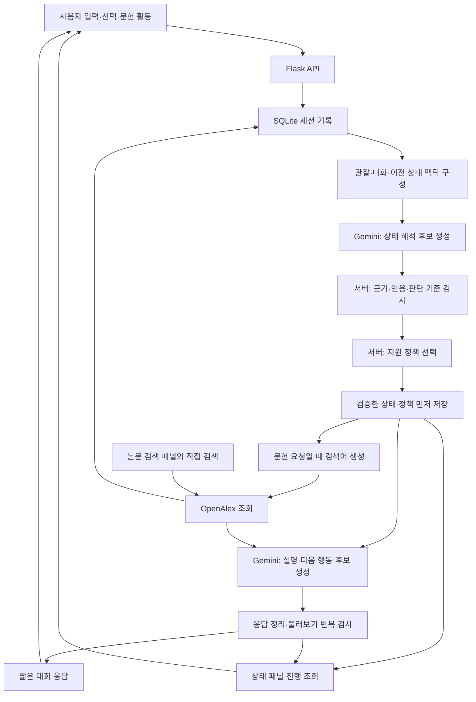

# HCI Korea 2027 · 탐색 인지 상태 기반 학술 탐색 시스템

**사용자의 단일 학술 탐색 세션에서 드러나는 관심, 연구 문제의 구체화 정도, 어려움을 추정하고, 그 근거를 보여주며 다음 탐색 방향을 제안하는 로컬 웹 프로토타입입니다.**

연구 주제를 처음 탐색하는 사용자는 추천 키워드를 따라가더라도 무엇을 살펴봤는지, 연구 방향이 얼마나 구체화되었는지, 다음에는 무엇을 알아보면 좋을지 판단하기 어렵습니다. 이 시스템은 **짧은 탐색 대화**, **근거를 포함한 상세 상태 패널**, **독립적인 문헌 검색**을 함께 제공하여 그 과정을 지원합니다.

- 개발 폴더: `11.09`
- 현재 지원 정책: `11.11-v2`
- 상태 판단 기준: `11.11-v2` / 상세 패널 표현: `11.10-v3`
- 구성: Python / Flask / SQLite / HTML·CSS·JavaScript / Gemini API / OpenAlex API
- 기본 실행 주소: **http://127.0.0.1:5109**

이 문서는 현재 구현을 설명합니다. 이전 버전의 변경·검증 기록은 [구현 기록](docs/IMPLEMENTATION.md)과 [검증 기록](docs/TEST_REPORT.md)에 있으며, 과거 절의 동작은 현재 정책과 다를 수 있습니다.

## 1. 연구 목적과 시스템의 범위

### 탐색 인지 상태란?

**사용자의 입력과 선택, 세션 내 상호작용을 바탕으로 현재 살펴보는 연구 방향, 연구할 문제의 구체화 정도, 탐색 과정에서 드러난 어려움과 그 변화를 표현한 세션 단위의 추정 상태**입니다.

현재 구현은 사용자의 숨은 생각을 직접 측정하지 않습니다. 관찰한 행동과 발화, 시스템이 제안한 해석, 판단을 보류한 내용을 구분합니다.

| 연구 범위 | 현재 구현 |
| --- | --- |
| 주요 목적 | 연구할 문제와 다음 탐색 방향을 형성하도록 지원 |
| 분석 단위 | 하나의 탐색 세션 |
| 주요 입력 | 사용자 발화, 후보 선택·둘러보기·구체화하기, 문헌 검색·초록·원문 링크·저장 활동 |
| 주요 출력 | 현재 상태 요약, 필요한 설명, 다음 행동, 관련 후보, 상태의 근거·변화 |
| 사용자 모델 | 세션 안에서 드러난 정보와 상호작용 |
| 문헌 검색 | OpenAlex의 실제 메타데이터와 초록 조회 |

다른 사용자의 과거 검색 세션 검색, 세션 클러스터링, 장기 연구자 프로필, 지식 그래프, 최근 연구 동향 보고서는 현재 구성에 포함하지 않습니다. 문헌 찾기는 연구 방향을 검토하는 수단이며, 시스템의 최종 목적을 논문 검색 성공만으로 정의하지 않습니다.

## 2. 빠른 실행

### 준비

- Python 3: 현재 자동 검사 환경은 **Python 3.13.14**입니다.
- Gemini API 키: 실제 상태 해석과 답변 생성에 사용합니다.
- OpenAlex API 키: 필요한 경우 문헌 검색에 사용합니다.
- Node.js: JavaScript 검사를 실행할 때 사용하며, 앱 실행 자체에는 필요하지 않습니다.

### 터미널에서 실행

```bash
git clone https://github.com/beblack127/HCI_Korea_2027.git
cd HCI_Korea_2027
python3 -m venv .venv
source .venv/bin/activate
python -m pip install -r requirements.txt
cp .env.example .env
```

`.env`의 `GEMINI_API_KEY`와 필요한 OpenAlex 설정을 입력한 뒤 실행합니다.

```bash
python app.py
```

브라우저에서 **http://127.0.0.1:5109** 를 엽니다. 서버는 `127.0.0.1`에 바인딩하며, 별도 프런트엔드 빌드나 데이터베이스 서버는 필요하지 않습니다. GitHub에 코드를 올리는 것만으로 웹 서비스가 배포되지는 않습니다.

### macOS 실행 파일

1. `setup.command`: 가상환경과 의존성을 설치합니다.
2. `.env.example`을 `.env`로 복사하고 API 키를 입력합니다.
3. `run.command`: 가상환경의 Python이 있으면 이를 사용해 앱을 실행합니다.

`.env`를 수정한 뒤에는 실행 중인 서버를 종료하고 다시 실행해야 합니다.

### API 키가 없는 경우

`APP_MODE=auto`에서 Gemini 키가 없으면 **규칙·템플릿 미리보기 모드**로 실행됩니다. 화면에 미리보기임을 표시하며, 실제 LLM의 상태 해석이나 주제 설명을 수행했다고 표시하지 않습니다. 키가 설정된 상태에서 API가 실패하면 오류를 표시하고, 미리보기 답변으로 자동 전환하지 않습니다.

## 3. 사용 흐름과 화면

데스크톱 화면은 다음 순서입니다.

```text
논문 검색 패널  |  탐색 대화  |  탐색 상태 패널
```

| 영역 | 역할 |
| --- | --- |
| 논문 검색 | 검색어·연도·정렬 조건으로 문헌을 찾고 초록 확인, 원문 링크 열기, 관심 논문 저장 수행 |
| 탐색 대화 | 관심 입력, 설명·비교 요청, 후보 탐색, 다음 행동 확인 |
| 탐색 상태 | 현재 방향·구체화 정도·어려움·변화·실제 활동·판단 근거·추천 이유 확인 |

기본 사용 예시는 다음과 같습니다.

1. `사용자 적응형 LLM 에이전트`처럼 관심 키워드나 질문을 입력합니다.
2. 짧은 상태 요약과 다음 탐색 후보를 확인합니다.
3. 후보를 선택한 뒤 **둘러보기** 또는 **구체화하기**를 누릅니다.
4. 필요한 경우 개념 설명이나 후보 비교를 대화로 요청합니다.
5. 후보별 영어 검색어로 문헌을 검색하거나 검색 패널에서 직접 검색합니다.
6. 상태 패널에서 지금까지 어떤 방향을 검토했고 다음 행동을 제안한 이유가 무엇인지 확인합니다.

후보를 클릭하는 것만으로는 LLM을 호출하지 않습니다. 대화 전송, 둘러보기, 구체화하기처럼 사용자가 탐색을 이어가는 요청에서 상태를 다시 추정합니다.

사용자 입력은 전송 즉시 오른쪽 말풍선으로 표시됩니다. 생성 중에는 경과 시간과 처리 단계를 보여주고, 서버가 저장을 확인하면 임시 말풍선을 실제 메시지와 연결해 중복 표시를 방지합니다. 현재 응답은 토큰 스트리밍 방식이 아니라 완성된 JSON을 받은 뒤 표시합니다.

## 4. 전체 아키텍처



핵심은 **관찰 → LLM 해석 → 서버 검증 → 지원 선택 → 표현**을 구분하는 것입니다. LLM이 사용자 상태부터 지원 방식까지 모두 자유롭게 결정하는 구조가 아닙니다.

| 구성 요소 | 담당 |
| --- | --- |
| 사용자 입력·행동 기록 | 브라우저와 Flask API |
| 현재 방향·문제·어려움에 대한 해석 후보 | Gemini |
| 이벤트 참조·원문 인용·보수적 판단 기준 검사 | `core/state.py` |
| 어떤 지원을 제공할지 선택 | `core/policy.py` |
| 짧은 대화와 상세 패널의 공통 상태 구성 | `core/presentation.py` |
| 설명·다음 행동·후보 내용 작성 | Gemini + `prompts/respond.txt` |
| 문헌 메타데이터·초록 조회 | `core/search.py`와 OpenAlex |
| 둘러보기의 빈 설명·후보 반복 검사 | `core/browse.py` |
| 세션 정리 준비도·근거 기반 정리 결과 | `core/readiness.py` |
| 기록·재시도·완료 응답 보관 | `core/storage.py` |

## 5. 한 번의 탐색 요청은 어떻게 처리되는가?

실제 처리의 중심은 [`Workspace._turn()`과 `_respond()`](core/service.py)입니다.

### ① 사용자 요청을 먼저 기록

모든 요청에는 `request_id`가 있습니다. 자유 입력이면 `user_input`, 버튼 요청이면 `topic_browse` 또는 `topic_refine` 이벤트와 사용자 메시지를 저장합니다.

버튼 요청은 현재 세션에서 시스템이 실제로 제공했던 추천 ID를 확인합니다. 다른 세션의 후보나 존재하지 않는 후보를 임의로 사용하지 않습니다.

### ② 상태 해석에 필요한 맥락 구성

모델에 전달하는 맥락은 다음과 같습니다.

- 최근 관찰 이벤트 최대 160개와 필요한 경우 첫 사용자 입력
- 최근 대화 메시지 최대 8개
- 이전의 검증된 추정 상태
- 직전 추천 목록과 이번에 선택한 후보
- 여러 행동을 묶은 약한 보조 신호
- 실제 상호작용한 최근 문헌 최대 12개의 정보: 초록은 문헌별 최대 4,000자로 제한

전체 세션 기록은 SQLite에 유지합니다. 모델 입력 창만 제한하며, 로그를 삭제해 문맥을 줄이지 않습니다. 이전 시스템 응답과 모델 원본 추정을 다시 사용자 관찰처럼 중복 전달하지 않습니다.

### ③ Gemini가 구조화된 상태 해석 후보를 반환

[`prompts/estimate.txt`](prompts/estimate.txt)와 [`core/schemas.py`](core/schemas.py)에 따라 현재 방향, 연구 문제, 어려움, 근거 인용, 지원 요청 등을 JSON으로 반환합니다.

이 결과는 곧바로 화면에 표시할 확정 상태가 아닙니다.

### ④ 서버가 근거를 검사하고 상태를 구성

[`validate_state()`](core/state.py)가 실제 이벤트 ID인지, 인용이 사용자 발화에 존재하는지, 문제·어려움 표현이 보수적 기준에 맞는지 검사합니다. 이어 [`enrich_state()`](core/presentation.py)가 실제 활동과 검증한 상태에서 화면용 변화·이력·요약을 구성합니다.

### ⑤ 서버 정책으로 지원 방식 결정

이번 요청과 검증한 상태를 바탕으로 `browse`, `concept`, `compare`, `formulate` 등의 지원 모드를 선택합니다. 모델이 이 정책을 임의로 덮어쓰지 않도록 응답 입력에 `support_plan`을 제공합니다.

### ⑥ 답변 생성 전에 상태를 저장

추정 상태·지원 정책·기본 다음 행동을 먼저 저장하고 `response_status=generating`으로 표시합니다. 브라우저는 진행 조회를 통해 답변이 완성되기 전에도 저장된 상태를 확인할 수 있습니다.

### ⑦ 필요한 설명과 후보 생성

평소에는 상태 해석 1회와 응답 생성 1회, 총 **2번의 모델 호출**을 사용합니다. 명시적인 문헌 지원 모드에서는 검색어 생성 호출과 OpenAlex 검색이 추가됩니다.

응답은 서버에서 길이·문헌 ID·다음 행동 등을 정리합니다. 둘러보기에는 별도의 반복 검사가 적용됩니다.

### ⑧ 결과와 추정의 연결을 보관

완성된 응답, 이를 생성한 추정의 `through_event_id`, 지원 정책, 모델·프롬프트 정보, 처리 시간을 저장합니다. 실패했다면 추정 상태를 보존한 채 `response_status=error`와 오류를 기록합니다.

## 6. 탐색 상태의 정의와 판단 기준

### 6.1 방향 정립 정도

| 값 | 표시 | 의미 |
| --- | --- | --- |
| `exploring` | 방향 탐색 | 관심 분야와 후보를 살펴보지만 다룰 연구 문제는 아직 충분히 드러나지 않음 |
| `forming` | 방향 형성 | 사용자 발화에서 연구할 문제가 드러나고 그 안의 범위·관점 등을 검토함 |
| `unknown` | 판단 유보 | 현재 기록으로 두 상태를 구분할 근거가 부족함 |

`unknown`은 이론적인 세 번째 탐색 단계가 아닙니다. 상태는 선형으로 진행하지 않으며, 새로운 관심으로 이동하거나 이전 방향을 다시 둘러볼 수 있습니다.

`forming` 판정에는 근거가 있는 `research_problem`이 필요합니다. 서버는 실제 발화의 정확한 인용, 문제를 드러내는 표현, 문제 설명과 발화 사이의 내용어 연결을 검사합니다. 근거가 부족하면 `forming`을 `unknown`으로 낮춥니다.

**같은 방향인지에 대한 의미 해석은 LLM이 제안**합니다. 서버는 주제 전환에 최신 입력·선택의 근거가 있는지 확인하고, 전환 후 과거 연구 문제·인용이 현재 상태에 잘못 이어지지 않도록 제한합니다. 단어 유사도만으로 방향의 동일성을 확정하지 않습니다.

### 6.2 어려움 유형

방향 정립 정도와 어려움은 독립적인 차원입니다. 방향이 형성된 사용자도 개념 이해나 주제 구체화에서 어려움을 겪을 수 있습니다.

| 값 | 의미 | 직접 표현의 예 |
| --- | --- | --- |
| `concept` | 용어·개념을 이해하는 데 어려움 | 설명을 봐도 이 개념이 이해가 안 돼 |
| `connection` | 추천이 현재 관심과 이어지는 이유를 판단하기 어려움 | 이게 내 관심과 어떻게 연결되는지 모르겠어 |
| `selection` | 후보를 비교하거나 고를 기준을 세우기 어려움 | 이 후보 중 무엇을 기준으로 비교할지 모르겠어 |
| `formulation` | 관심을 연구할 문제·질문·범위로 바꾸기 어려움 | 이 방향을 연구 주제로 어떻게 구체화할지 모르겠어 |

`DST가 뭐야?`는 설명 요청이며, 그 자체로 개념 이해의 어려움을 확정하지 않습니다. `다른 주제는 없어?` 역시 새 후보 요청일 수 있으므로 선택 어려움으로 자동 분류하지 않습니다.

### 6.3 어려움의 상태와 이력

| 구분 | 값 | 해석 |
| --- | --- | --- |
| 현재 판단 | `unknown` | 어려움 유무를 판단할 근거 부족 |
| 현재 판단 | `possible` | 여러 행동과 맥락에서 지원 필요 가능성이 드러남 |
| 현재 판단 | `expressed` | 사용자가 해당 어려움을 직접 표현함 |
| 현재 판단 | `clear` | 후속 발화에서 어려움 해소 표현이 확인됨 |
| 이력 | `active` | 현재 맥락에서 어려움 근거가 확인됨 |
| 이력 | `unconfirmed` | 후속 확인 전이며 해소 여부를 단정하지 않음 |
| 이력 | `resolved` | 해당 어려움의 해소를 뒷받침하는 후속 표현이 있음 |
| 이력 | `out_of_scope` | 현재 탐색 방향 밖에 있는 과거 어려움 |

설명을 제공했다는 사실이나 사용자의 감사만으로 해결을 판정하지 않습니다. 여러 어려움 중 일부만 해소되는 경우도 구분합니다.

### 6.4 행동 로그를 해석하는 범위

후보 재방문, 검색어 변경과 여러 문헌 검토의 조합을 보조 신호로 구성합니다. 단일 클릭·초록 열기·원문 링크·저장으로 어려움이나 이해를 확정하지 않습니다. 현재 `possible` 판단 역시 모델이 제안한 유형, 여러 관찰의 조합, 관련 맥락을 함께 검사하는 보수적인 방식입니다.

현재 코드의 원문·정규식·내용어 검사는 **근거가 없는 해석을 줄이는 휴리스틱**입니다. 심리적 진실이나 추정 정확도를 보장하는 검증은 아닙니다.

## 7. 상태에 따른 지원 선택

지원 정책은 [`core/policy.py`](core/policy.py)에 있습니다.

우선순위는 **이번 버튼 요청 → 이번의 명시적인 설명·비교·문헌 요청 → 현재 어려움에 맞는 도움 → 기본 방향 추천**입니다. 예를 들어 개념 어려움이 기록되어 있어도 사용자가 이번에 문헌을 요청했다면 이번 문헌 요청을 우선합니다.

| 지원 모드 | 제공 내용 | 추천과의 연결 |
| --- | --- | --- |
| `directions` | 다음 연구 방향 후보와 행동 | 현재 관심에 맞는 서로 다른 방향 |
| `browse` | 선택한 주제의 의미·문제·상황 예시 | 그 주제와 연결되는 측면 3개 |
| `concept` | 개념·예시의 짧은 설명 | 설명한 개념과 관심을 연결하는 후보 |
| `connection` | 현재 관심과 추천 내용의 연결 설명 | 관련성을 검토할 수 있는 후보 |
| `compare` | 기존 후보의 차이와 비교 기준 | 기존 후보를 유지·보완 |
| `formulate` | 연구할 문제·질문·범위의 구체화 예시 | 선택한 방향 안의 범위·관점 |
| `literature` | 실제 검색한 문헌의 초록·메타데이터에 근거한 안내 | 문헌에서 이어지는 문제·키워드 |

탐색을 이어가는 지원 모드에서는 후보를 **기본 3개** 제안하도록 요청합니다. 일반 응답의 서버 검사는 유효 후보가 하나도 없는 경우를 거부하며, 둘러보기에서는 정확히 3개인지까지 검사합니다. 사용자가 세션 정리를 선택한 응답은 새 후보 대신 정리 결과를 제공합니다.

사용자가 이해했다고 가정하거나 결정을 재촉하는 다음 행동은 보정합니다. 개념 어려움의 해소가 확인되지 않았다면 후보를 제공하더라도 개념을 더 살펴보는 행동을 우선할 수 있습니다.

## 8. 짧은 대화와 상세 상태 패널

### 대화 응답

```text
현재 상태 한 문장
→ 이번 요청에 필요한 설명 하나
→ 다음에 할 행동 한 문장
→ 주제·키워드 후보 기본 3개
```

- 상태 한 문장은 검증한 상태에서 서버가 구성한 `chat_summary`입니다.
- 설명은 기본 1~2문장으로 정리하며, 표시 미리보기는 최대 320자입니다.
- 긴 원문 설명은 `assistance.details`에 보관해 펼쳐 볼 수 있습니다.
- `자세히`, `상세히`, `단계별로` 등 명시적인 상세 요청이면 설명을 기본 펼침으로 표시합니다.
- 기본 `directions` 모드에서는 별도의 일반 설명을 생략합니다. **둘러보기는 이 모드와 분리되어 설명이 필수입니다.**
- 다음 행동은 한 문장으로 표시하고, 상세한 추천 이유는 상태 패널에 둡니다.

### 상태 패널

| 항목 | 내용 |
| --- | --- |
| 현재 방향·상태 | 관심 방향, 방향 탐색/형성/판단 유보, 상세 요약 |
| 최근 변화 | 실제 최신 입력·선택에서 무엇이 추가됐는지 |
| 발화에서 드러난 내용 | 실제 인용으로 확인한 관심·연구 문제·관점·범위 |
| 검토 중인 방향 | 실제 선택·둘러보기·구체화하기 이력 |
| 확인할 질문 | 아직 기록에서 확인하지 못한 문제·범위 등 |
| 어려움과 이력 | 현재 어려움, 원문 근거, 후속 확인·해소 여부 |
| 다음 단계와 이유 | 제안한 행동과 현재 탐색에 연결되는 이유 |
| 후보별 연결 | 현재 관심과 각 추천을 연결한 시스템의 제안 |
| 탐색 흐름·전체 기록 | 선택 이후 검색·초록·원문 링크·저장 등 실제 활동 |

`아직 기록에 드러나지 않음`과 `사용자가 정하지 못함`은 다르게 취급합니다. 시스템이 제시한 후보는 사용자가 검토한 방향으로 기록하지 않으며, 실제 선택한 후보를 별도로 표시합니다.

대화와 패널은 **하나의 검증된 상태를 서로 다른 상세도로 표현**합니다. 패널을 위해 별도의 상태 추정 API를 한 번 더 호출하지 않습니다.

## 9. 둘러보기와 구체화하기의 차이

| 행동 | 목적 | 응답의 초점 |
| --- | --- | --- |
| 둘러보기 | 선택한 주제가 무엇을 다루는지 이해하고 관련 측면 검토 | 문제 설명, 상황 예시, 관련 측면 |
| 구체화하기 | 관심 있는 문제의 대상·상황·범위를 좁혀보기 | 연구 문제·질문·범위 후보 |

예를 들어 `사용자 상태 인식 아키텍처`를 둘러본다면, 대화·선택을 단서로 상태를 추정하고 지원을 조정한다는 의미와 상황 예시를 설명한 뒤, `상태를 파악할 단서 / 상태 변화의 반영 / 잘못된 추정의 수정` 같은 측면을 제안할 수 있습니다. 이는 응답 구조를 설명하는 예시이며 고정 후보 목록은 아닙니다.

### 11.11-v1에서 수정한 문제

이전에는 둘러보기가 설명을 생략하는 `directions` 모드로 처리되어 본문이 비고 기존 후보 세트가 반복될 수 있었습니다. 현재는 다음과 같이 처리합니다.

1. `browse` 전용 모드와 `recommendation_focus=selected_direction`을 사용합니다.
2. 선택한 주제가 다루는 문제와 상황 예시를 설명합니다.
3. 프롬프트는 클릭한 주제·형제 후보를 재나열하지 않고 관련 측면 3개를 제안하도록 합니다.
4. 서버는 빈 설명, 후보 수 부족, 내부 중복, 빈 설명·검색어, 직전 후보 세트의 반복을 검사합니다.
5. 내용 검사가 실패하면 **상태를 다시 추정하지 않고 응답만 최대 한 번 재생성**합니다.
6. 재생성도 실패하면 상태를 보관하고 수동 재시도 안내를 표시합니다.

반복 검사는 Unicode·공백·문장부호를 정규화한 제목과 설명을 사용합니다. 추천 ID나 순서만 바뀌어도 같은 3개 세트면 탐지합니다. 관련성·동의어 수준의 반복을 의미적으로 검증하는 기능은 아닙니다.

검사 과정은 `provenance.browse_validation`에 기록합니다. 기존 후보를 유지하는 것이 필요한 `compare` 모드에는 이 반복 검사를 적용하지 않습니다. Gemini 서버 오류 자체를 자동 재호출하는 기능과도 구분합니다.

### 탐색 마무리 준비도와 잠정 정리 · 11.11-v2

`forming`과 별개로 `readiness`를 구성합니다. 연구 주제가 학술적으로 완성됐다는 판정이 아니라, 이번 세션을 잠정적으로 정리할 근거가 있는지 확인하는 기능입니다.

| 기준 | 현재 구현의 확인 방법 |
| --- | --- |
| 연구할 문제 | 실제 사용자 발화의 근거 인용을 통과한 `research_problem` |
| 구별되는 관점·범위 | 사용자 원문에서 확인한 `perspective` 또는 `scope` 인용 |
| 같은 방향으로 이어진 탐색 | 이전에도 근거 있는 연구 문제가 있고, 이후 의도적 입력·선택이 이어지며 현재 `topic_relation=same`인 경우 |

세 기준을 충족하고 현재 방향 상태가 `forming`이면 정리 준비도를 `ready`로 둡니다. 클릭 수·독서 시간·문헌 저장 수만으로 준비됐다고 판단하지 않습니다. 같은 방향이라는 의미 해석은 기존 LLM 결과를 사용하므로 이 기준 역시 사용자 연구로 검증할 설계 가설입니다.

- 다음 방향 제안·둘러보기·구체화 응답에서 **‘탐색 정리하기’ 버튼 하나**를 조건부로 제시합니다. 둘러보기·구체화하기는 계속 사용할 수 있고 종료를 강제하지 않습니다.
- 같은 문제·관점·범위 표현으로 구성한 제안은 반복하지 않습니다. 명시적인 현재 어려움이 있거나 개념·비교·문헌 지원을 제공하는 응답에서는 자동 제안을 미룹니다.
- 준비도는 `not_ready / ready / confirmed`이며 기존 탐색 인지 상태를 대체하지 않습니다. 준비도 계산 때문에 모델을 추가 호출하지 않습니다.
- 사용자가 버튼을 선택하면 `session_wrapup` 이벤트와 확인 상태를 기록하고, 검증된 연구 문제·관점·검토한 방향·미결 질문·후속 검토를 정리합니다. 확인 시 모델 호출은 **0회**입니다. 임의의 연구 질문·실험 방법을 만들어 사용자가 정한 내용으로 표시하지 않습니다.
- 최신 상태와 다른 제안, 새 탐색 입력이 아직 추정되지 않은 오래된 제안, 다른 세션의 제안은 확인할 수 없습니다. 같은 요청을 재시도해도 정리 기록이 중복되지 않습니다.
- 정리 뒤에도 입력창에서 탐색을 이어갈 수 있습니다. 이후 응답에는 다시 기본 후보 3개를 제공하며 같은 정리 제안을 반복하지 않습니다. 원본 대화와 이전 추정은 유지합니다.

상태 패널에는 준비도와 세 판단 기준을 표시합니다. ‘차이 정리하기’ 등 새로운 어려움 선택지는 추가하지 않았으며, 어려움 유형·직접 표현 판정 기준은 이번 업데이트에서 바꾸지 않았습니다.

## 10. 문헌 검색과 행동 로그

### 독립적인 검색

검색 패널에서 직접 검색하거나 후보의 영어 검색어 버튼을 누르면 OpenAlex를 조회합니다. 이 동작 자체는 LLM 상태 추정이나 대화 생성을 호출하지 않습니다.

| 기능 | 구현 |
| --- | --- |
| 조회 데이터 | 제목, 저자, 발행연도, 초록, DOI·원문·OA 링크, 인용 수 등 |
| 초록 | OpenAlex의 inverted index에서 가능한 경우 복원 |
| 결과 수 | 페이지당 10개, 최대 50페이지 범위 |
| 정렬 | 관련성 / 최신순 / 인용순 |
| 발행연도 | 시작·종료 연도를 자유롭게 지정, 한쪽만 지정하거나 같은 연도 지정 가능 |
| 원문 | 외부 링크로 이동; 내부 PDF 뷰어는 없음 |
| 관심 표시 | 논문 저장·해제 |
| 캐시 | 검색어·페이지·정렬·연도 조건 등에 따른 1시간 캐시 |

현재 날짜 이후의 문헌을 제외하도록 조회 조건을 설정합니다. 초록·원문 링크가 없을 수 있으며 없는 정보를 임의로 생성하지 않습니다. 문헌 지원 응답에는 실제로 공급한 문헌 ID만 연결합니다.

### 다음 상태 추정에 활용하는 방식

검색어, 결과 위치, 초록 펼치기·접기, 원문 링크 열기, 저장·해제 등을 이벤트로 보관합니다. 이러한 활동은 다음 대화·둘러보기·구체화하기 요청의 맥락에 반영됩니다.

**원문 링크를 열었다는 기록은 실제로 읽거나 이해했다는 기록이 아닙니다.** 외부 페이지의 독서 시간과 이해도, 실제 PDF 독서 여부는 현재 수집하지 않습니다. 저장 역시 관심 표현·검토 시도의 단서로 사용합니다.

## 11. 데이터 저장과 세션 관리

데이터는 실행 시 생성하는 `data/workspace.sqlite3`에 저장합니다. SQLite는 WAL 모드를 사용합니다.

| 테이블 | 역할 |
| --- | --- |
| `sessions` | 세션 ID·생성 시각·제목·조건 |
| `events` | 원시 입력·행동과 시스템 처리 이벤트 |
| `messages` | 대화 화면의 사용자·에이전트 메시지 |
| `estimates` | 요청별 검증 상태·지원 정책·근거와 실행 정보 |
| `turns` | 완료된 요청의 응답; 동일 요청의 중복 처리 방지 |
| `papers` | 해당 세션에서 조회한 문헌과 저장 여부 |
| `search_cache` | 조건별 OpenAlex 결과 캐시 |

사용자 관찰로 쓰는 이벤트와 `state_estimated`, `agent_response`, `model_error` 같은 처리 이벤트를 구분합니다. 시스템의 이전 추천이나 추정 자체를 사용자 동의의 증거로 삼지 않습니다.

### 근거와 재현 정보

- `request_id`: 같은 요청의 재시도인지 구분합니다.
- `client_id`: 관찰 이벤트의 중복 저장을 방지합니다.
- `through_event_id`: 어느 관찰까지 포함한 추정인지 나타냅니다.
- `state`, `plan`: 검증한 상태와 실제 적용한 지원 정책입니다.
- `provenance`: 모델·API 방식·판단 기준 버전·정책 버전·프롬프트 해시·검증 경고·처리 시간 등을 보관합니다.
- `raw_estimate`: 모델의 구조화된 상태 해석 원본입니다. 최종 검증 결과와 구분합니다.
- `data/prompt_versions/`: 사용한 프롬프트와 판단 기준의 사본을 보관합니다.

모델의 비공개 사고 과정은 요청·저장하지 않습니다. 화면의 생성 타이머는 서버의 처리 단계와 경과 시간입니다.

브라우저 쿠키가 유지되면 같은 세션을 복원합니다. 새 탐색은 새 세션을 만들며 기존 세션을 삭제하지 않습니다. 현재 세션을 JSON으로 내보낼 수 있습니다. 브라우저 로그인·계정 동기화·세션 목록에서 과거 탐색을 다시 여는 기능은 현재 범위에 포함하지 않습니다.

## 12. 실패·재시도 처리

- 요청을 보내면 사용자 입력부터 보관합니다.
- 답변 생성이 실패하더라도 이미 검증한 상태는 보존합니다.
- 같은 `request_id`를 재시도하면 관찰·프롬프트가 동일한 경우 추정을 재사용합니다.
- 완료된 동일 요청은 저장한 결과를 반환하며 메시지와 행동을 중복 생성하지 않습니다.
- 같은 문장을 사용자가 새 요청으로 다시 보낸 경우에는 별도 입력으로 기록합니다.
- 같은 세션의 턴은 잠금으로 직렬 처리합니다.

| 오류 상황 | 의미와 처리 |
| --- | --- |
| 키 인증·접근 오류 | `.env`와 모델 접근 설정 확인 |
| 제공자 HTTP 429 | 호출 제한·할당량 관련 오류 안내 |
| 제공자 HTTP 500/502/503/504 | 일시적인 제공자 오류로 안내하고 입력 보관 |
| 응답 시간 초과 | 해당 모델 호출 대기 제한에 도달; 입력과 저장된 추정 보관 |
| 설명·후보 부족 | 빈 응답을 정상 결과로 표시하지 않음; 둘러보기는 한 번 내용 보정 |
| OpenAlex 오류 | 검색 오류 표시; 대화의 문헌 조회 실패는 해당 상태를 응답에 표시 |

Gemini·검색 처리 오류는 로컬 API에서 HTTP 502로 전달할 수 있으므로, **로컬 HTTP 상태와 오류 메시지에 포함된 제공자 HTTP 상태는 다를 수 있습니다.** 제공자 과부하는 로컬 서버 재시작만으로 해결되는 문제가 아닐 수 있습니다.

`GEMINI_TIMEOUT_SECONDS=300`은 모델 호출별 응답 대기 설정입니다. 상태 해석과 응답 생성이 순차 실행되므로 전체 턴의 제한이 300초라는 뜻은 아닙니다. 실제 속도는 모델과 서비스 상황에 따라 달라집니다.

## 13. 환경 설정

실제 키는 `.env`에만 입력합니다. 설정은 [`core/config.py`](core/config.py)에서 서버 시작 시 읽습니다.

| 변수 | 기본값 | 설명 |
| --- | --- | --- |
| `GEMINI_API_KEY` | 빈 값 | 실제 Gemini 호출 키 |
| `GEMINI_MODEL` | `gemini-3.1-flash-lite` | 현재 코드의 기본 모델 |
| `GEMINI_API_STYLE` | `generate_content` | 기본 `generateContent` 연결 방식; `interactions` 분기도 코드에 존재 |
| `GEMINI_THINKING_LEVEL` | Flash Lite 기본 `minimal` | 모델 호출의 thinking 설정 |
| `GEMINI_TIMEOUT_SECONDS` | `300` | 개별 모델 호출의 응답 대기 시간 |
| `APP_MODE` | `auto` | 키가 있으면 실제 호출, 없으면 미리보기; `preview`면 항상 미리보기 |
| `PORT` | `5109` | 로컬 실행 포트 |
| `OPENALEX_API_KEY` | 빈 값 | OpenAlex 인증 설정 |
| `OPENALEX_MAILTO` | 빈 값 | 선택적인 연락처 설정 |

기본 연결은 JSON schema를 포함한 `generateContent` 요청이며 최종 텍스트만 읽습니다. 지원하는 모델명·접근 권한은 사용 중인 계정에서 확인해야 합니다. 모델을 바꾸면 상태와 응답 품질·속도도 다시 점검해야 합니다.

현재 상태 조회:

```bash
curl http://127.0.0.1:5109/api/status
```

이 조회의 `configured=true`는 키가 설정되어 있다는 뜻이며 실제 생성 성공을 보장하지 않습니다. 실제 연결 진단은 `python check_connection.py`로 실행할 수 있습니다. 이 진단은 모델 호출을 수행합니다.

## 14. API 구성

| 메서드 | 경로 | 역할 |
| --- | --- | --- |
| GET | `/` | 앱 화면 |
| GET | `/api/status` | 모드·모델·정책 버전·설정 여부 |
| GET | `/api/workspace` | 현재 세션 스냅샷 |
| POST | `/api/session/new` | 새 탐색 세션 생성 |
| POST | `/api/turn` | 자유 입력·둘러보기·구체화하기·탐색 정리 확인 |
| GET | `/api/turn/progress?request_id=...` | 처리 단계·경과 시간·먼저 저장한 상태 |
| POST | `/api/events` | 후보 선택·논문 행동 기록 |
| POST | `/api/papers/search` | 독립적인 문헌 검색 |
| GET | `/api/session/export` | 현재 세션 JSON 내보내기 |

POST 요청에는 JSON과 `X-Workspace-Request: 1` 헤더를 사용합니다. 브라우저는 같은 출처의 세션 쿠키를 전달합니다. 다른 출처에서 보낸 POST는 거부합니다.

자유 입력 요청의 형태:

```json
{
  "request_id": "unique-request-id",
  "action": "message",
  "text": "사용자 상태를 반영하는 LLM 에이전트를 탐색하고 싶어"
}
```

둘러보기 요청의 형태:

```json
{
  "request_id": "another-unique-request-id",
  "action": "browse",
  "recommendation_id": "현재 세션에서 제공된 실제 후보 ID"
}
```

`action=refine`은 구체화하기입니다. 자세한 입력 검사는 [`app.py`](app.py)와 [`core/service.py`](core/service.py)를 참조합니다.

정리 확인은 `action=wrapup`, 고유 `request_id`, 현재 응답에서 제안된 `readiness_signature`를 전달합니다. 서버가 현재 세션의 최신 준비도와 실제 제안 여부를 확인하며, 임의의 서명만으로 종료 상태를 만들 수 없습니다.

## 15. 디렉터리와 수정 지점

```text
.
├── app.py                      # Flask 앱, API, 세션, 오류 처리
├── check_connection.py         # 실제 Gemini 연결 점검
├── requirements.txt            # Flask와 requests
├── .env.example                # 키가 없는 설정 예시
├── .gitignore                  # 키·사용 로그·로컬 생성물 제외
├── run.command                 # macOS 실행
├── setup.command               # macOS 설치
├── config/
│   └── state_criteria.json     # 연구자가 정의한 상태·어려움·원칙
├── core/
│   ├── config.py               # 환경 설정
│   ├── schemas.py              # 모델 JSON 응답 형태
│   ├── llm.py                  # Gemini 요청·응답·제공자 오류
│   ├── state.py                # 근거 검사·어려움 이력·미리보기
│   ├── presentation.py         # 짧은 대화와 상세 패널의 상태 표현
│   ├── policy.py               # 지원 방식과 추천 정책
│   ├── browse.py               # 둘러보기 구조·반복 검사
│   ├── readiness.py            # 탐색 정리 준비도·근거 기반 요약
│   ├── service.py              # 전체 턴·재시도·생성 파이프라인
│   ├── search.py               # OpenAlex 검색·초록·필터
│   └── storage.py              # SQLite 기록·복원·캐시
├── prompts/
│   ├── estimate.txt            # 상태 해석 지침
│   ├── respond.txt             # 설명·행동·후보 생성 지침
│   └── query.txt               # 문헌 지원 검색어 지침
├── templates/index.html       # 화면 구성
├── static/
│   ├── app.js                  # 대화·패널·검색·생성 타이머
│   ├── style.css               # 레이아웃·말풍선·상태 색상
│   └── favicon.svg
├── tests/                     # Python 및 JavaScript 회귀 검사
├── docs/                      # 설계·검증 기록
└── data/.gitkeep              # 실제 실행 데이터는 Git에서 제외
```

| 바꾸려는 내용 | 주요 수정 파일 |
| --- | --- |
| 탐색 상태·어려움의 개념과 원칙 | `config/state_criteria.json`, `prompts/estimate.txt` |
| 원문 근거 검사·보수적 판정 | `core/state.py`, 관련 Python 테스트 |
| 어떤 상태·요청에 어떤 지원을 줄지 | `core/policy.py` |
| 둘러보기 설명·후보 생성 지침 | `prompts/respond.txt` |
| 둘러보기 반복 감지·보정 흐름 | `core/browse.py`, `core/service.py` |
| 마무리 준비도·일회성 제안·정리 확인 | `core/readiness.py`, `core/service.py`, `static/app.js` |
| 대화 요약·상세 패널 항목 | `core/presentation.py`, `static/app.js` |
| 문헌 검색·필터·메타데이터 | `core/search.py`, `app.py` |
| 인터페이스 구성·스타일 | `templates/index.html`, `static/app.js`, `static/style.css` |

프롬프트만 수정하면 서버의 근거 검사나 지원 정책은 그대로입니다. 상태 정의를 바꾸는 경우에는 판단 기준, 프롬프트, 서버 검사, UI 표현, 테스트를 함께 점검해야 합니다.

## 16. 테스트와 현재 확인 범위

가상환경을 활성화하고 저장소 루트에서 실행합니다.

```bash
python -m unittest discover -s tests -q
node --test tests/frontend.test.cjs
```

2026-11-11 기준 자동 검사: **Python 107개 + JavaScript 26개 = 133개 통과**.

- 근거가 없는 연구 문제·어려움·인용의 거부
- 도움 요청과 직접 어려움의 구분
- 어려움 이력·부분 해소·주제 변경의 처리
- 짧은 대화와 상세 패널이 같은 상태를 사용함
- 독립적인 문헌 검색·자유 연도·저장·세션 분리
- 입력의 즉시 말풍선 표시·생성 중 상태 갱신·전송 동작
- 실패 후 상태 보존·추정 재사용·요청 중복 방지
- 둘러보기 설명·후보 반복 보정과 재생성 한도
- 비교 요청의 기존 후보 유지와 미리보기 구분
- 정리 준비도 근거, 제안 반복 방지, 오래된 제안 거부, 실패 후 상태 보존, 모델 호출 없는 정리 확인과 이후 탐색 재개

실제 Gemini에서도 임시 세션의 연속 둘러보기 두 번이 HTTP 200으로 완료되었고, 각각 설명과 새 후보 3개를 확인했습니다. 당시 약 4.82초·4.73초였으며 일반적인 성능을 보장하는 수치는 아닙니다. JavaScript 검사는 최소 DOM 모형을 이용하므로 실제 브라우저의 모든 화면·기기 검증과 동일하지 않습니다.

정리 기능도 실제 Gemini 임시 세션에서 준비도 판정·정리 제안 HTTP 200을 확인했습니다. 일반 응답은 모델 2회 호출·후보 3개, 정리 확인은 모델 0회 호출·새 후보 0개·확인 상태 저장으로 완료되었습니다. 최초 점검의 답변 생성 단계에서는 제공자 HTTP 503이 발생했고, 이후 별도 재점검에서 완료했습니다.

이 검사는 소프트웨어 동작과 회귀를 확인합니다. 인지 상태 추정 정확도, 후보의 연구적 가치, 사용자 주도성·인지 부담·방향 형성에 대한 효과는 사용자 연구로 별도 검증해야 합니다.

## 17. 저장소에 포함하지 않는 데이터

| 제외 대상 | 이유 |
| --- | --- |
| `.env`, 실제 키·인증 파일 | 로컬 API 설정 |
| `data/`의 DB·WAL·세션 비밀값·캐시·프롬프트 실행 사본 | 개인 탐색 기록과 실행 데이터 |
| 로컬 JSON 내보내기·진단·실제 API 실행 원본 | 대화·환경·실행 정보를 포함할 수 있음 |
| `.venv/`, `__pycache__/`, OS 파일 | 재생성할 수 있는 로컬 파일 |
| `.installation-manifest.json` | 로컬 설치 관리 파일 |

소스, 키 없는 `.env.example`, 판단 기준, 프롬프트, UI, 자동 테스트, Markdown 설계·검증 문서는 버전 관리합니다. 로컬 진단 JSON 파일은 저장소에서 제외하므로 과거 검증 문서에 적힌 개별 JSON 파일은 개발 환경에만 있을 수 있습니다.

로그 파일은 로컬에 저장하지만 실제 Gemini 모드에서는 선택된 대화·행동·문헌 맥락을 Gemini에 전달합니다. OpenAlex에는 검색어와 설정한 인증·연락처 정보를 전송합니다. 완전한 오프라인 처리 시스템은 아닙니다.

## 18. 연구에서 추가로 검증할 부분

현재 프로토타입에서 구현한 것은 상태·근거 표현과 지원 정책을 연결하는 동작입니다. 연구 기여의 검증에는 다음 과제가 남아 있습니다.

- 실제 탐색 세션에서 상태·어려움의 판단 기준이 타당한지 확인
- 사용자 자기보고·독립적인 연구자 코딩과 시스템 추정의 비교
- 현재 상태와 근거를 보여주는 패널이 탐색 이해와 다음 행동 결정에 미치는 영향
- 상태에 맞춘 지원이 일반적인 추천보다 도움이 되는지 비교
- 잘못된 추정, 판단 유보, 과도한 방향 전환·반복 추천의 사례 분석

`sessions.condition`은 조건을 기록할 필드이며, 현재 기본값은 `adaptive`입니다. 범용 LLM·비적응형·패널 없는 조건을 자동 분기하는 실험 시스템은 아직 구현되어 있지 않습니다. 장기 프로필, 독서 시간·이해도 측정, 내부 PDF 뷰어, 서비스 계정·배포 운영도 현재 범위 밖입니다.

## 19. 개발 경과

| 시점 | 주요 내용 |
| --- | --- |
| 11.09 | 독립적인 탐색 시스템, Gemini·OpenAlex, 세션 저장, 자유 연도 검색, 생성 타이머 |
| 11.09 UI 보완 | 논문 검색–대화–상태 배치, 둥근 말풍선·전송 동작, 어려움 색상·상세 표시 |
| 11.10 | 발화 근거 검사, 요청과 어려움 분리, 어려움 이력, 실패 후 상태 보존 |
| 11.10-v2 | 모든 응답에서 기본 후보 3개를 유지하고 지원 내용에 맞춰 연결 |
| 11.10-v3 | 짧은 대화·상세 상태 패널, 실제 선택·변화·탐색 흐름과 후보 이유 표시 |
| 11.11-v1 | 둘러보기 전용 설명, 관련 측면 추천, 후보 세트 반복 검사·한 번의 응답 보정 |
| 11.11-v2 | 별도의 탐색 정리 준비도, 한 번의 조건부 제안, 사용자 확인 후 근거 기반 정리·탐색 이어가기 |

자세한 구현 판단과 과거 검증 범위는 [IMPLEMENTATION.md](docs/IMPLEMENTATION.md), [TEST_REPORT.md](docs/TEST_REPORT.md)를 참조하세요.
